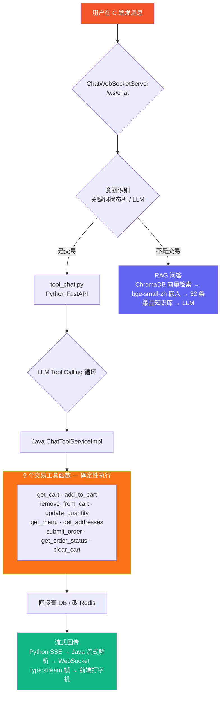

# 智膳 · 外卖点餐系统

> 基于黑马外卖教学项目二次开发的 **Spring Boot + Vue + Python 智能客服** 完整外卖系统。独立完成 Redis 缓存加固、订单可靠性改造、RAG 知识库、LLM Tool Calling 对话下单、SSE 流式输出等工程化功能。

---

## ✨ 亮点速览

| 模块 | 亮点 | 关键实现 |
| --- | --- | --- |
| **缓存** | 三重防护（穿透/击穿/雪崩）+ 故障熔断 | `CacheClient`：空值占位 + `SET NX` 互斥锁 + TTL 抖动 + 1s 超时 5s 熔断降级 |
| **订单** | 幂等 + 自动取消 | `SET NX EX 5` 用户级防重锁 + Redis ZSet 30 分钟延时队列 |
| **智能客服** | LLM 对话式点餐 | 9 个交易工具函数 + Tool Calling 循环 + 四层模糊匹配 + SSE→WebSocket 流式输出 |
| **架构** | 双链路隔离 | 咨询问答走 RAG / 交易下单走 Tool Calling，大模型幻觉不影响交易安全 |

## 技术栈

| 层 | 技术 |
| --- | --- |
| 后端主服务 | Spring Boot 2.7.3、MyBatis、MySQL 8、Redis（Lettuce）、JWT、WebSocket、Druid |
| 智能客服 | Python 3、FastAPI、ChromaDB、bge-small-zh（本地嵌入）、pinyin4j |
| C 端前端 | 原生 HTML/CSS/JS 单页应用（hash 路由，无构建） |
| B 端前端 | 原版 Vue + Element UI 编译产物 |
| 反向代理 | nginx（gzip + 静态资源缓存头） |
| 构建 | JDK 17、Maven 多模块 |

## 目录结构

```
zhishan-takeout/
├── sky-common/                 # 通用模块：常量/异常/JWT/OSS工具/JSON配置
├── sky-pojo/                   # Entity / DTO / VO
├── sky-server/                 # 启动模块
│   └── src/main/java/com/sky/
│       ├── controller/         # admin/ + user/ 两套
│       ├── service/            # impl/ 含 ChatToolServiceImpl
│       ├── cache/CacheClient   # 缓存三重防护统一封装
│       ├── config/             # Redis/WebSocket/WebMvc 配置
│       ├── websocket/          # ChatWebSocketServer + WebSocketServer
│       └── task/               # OrderTask(ZSet超时扫描) + WebSocketTask
├── 智能客服/
│   ├── app/                    # RAG：向量库 + 嵌入器 + 切分器
│   ├── data/knowledge_base.md  # 菜品知识库（32条）
│   ├── tool_chat.py            # LLM Tool Calling 对话入口
│   ├── web_app.py              # FastAPI：SSE流式端点 + Web UI
│   ├── ingest.py               # 知识库向量化入库
│   ├── requirements.txt
│   └── .env.example
├── Web/nginx-1.20.2/html/
│   ├── web-app/                # C端 H5（http://localhost/）
│   └── sky/                    # B端 PC后台（http://localhost/admin/）
├── sky_web.sql                 # 数据库脚本（含 chat_tool_log / chat_message 等智能客服表）
└── pom.xml                     # Maven 父POM
```

## 快速体验（5 分钟跑起来）

### 1. 启动后端 + 前端（不含智能客服）

```bash
# MySQL 建库导数据
mysql -uroot -p -e "CREATE DATABASE sky_web DEFAULT CHARSET utf8mb4"
mysql -uroot -p sky_web < sky_web.sql

# 启动 Redis（默认端口 6379）
redis-server

# 后端（端口 8080）
cd zhishan-takeout
mvn package -DskipTests
java -jar sky-server/target/sky-server-1.0-SNAPSHOT.jar

# nginx（端口 8，同时托管两个前端）
cd Web/nginx-1.20.2
nginx.exe
```

### 2. 启动智能客服（可选）

```bash
cd 智能客服
python -m venv .venv && .venv\Scripts\activate    # Windows
pip install -r requirements.txt
copy .env.example .env                              # 填入自己的 LLM API Key
python ingest.py                                    # 首次运行：向量化知识库
python tool_chat.py                                 # 启动 LLM Tool Calling 对话服务
python web_app.py                                   # 启动 SSE 流式端点 + 聊天 UI
```

### 3. 访问

| 端 | 地址 | 账号 |
| --- | --- | --- |
| C 端 H5 点餐 | http://localhost/ | `zhangsan` / `123456` |
| B 端 PC 后台 | http://localhost/admin/ | `admin` / `123456` |
| 智能客服 Web UI | http://localhost:8000/ （启动 web_app.py 后） | 无需账号 |

## nginx 路由

| 路径 | 去向 |
| --- | --- |
| `/` | C 端 H5（`html/web-app`） |
| `/admin/` | B 端 PC 后台（hash 路由） |
| `/user/**` → `localhost:8080/user/**` | C 端接口 |
| `/admin/**` → `localhost:8080/admin/**` | B 端接口 |
| `/ws/` | 后端 WebSocket 代理 |
| `/ws/chat` | 客服聊天 WebSocket |

## WebSocket 端点

| 端点 | 类 | 用途 |
| --- | --- | --- |
| `/ws/{sid}` | `WebSocketServer` | 来单提醒、催单提醒（商家端） |
| `/ws/chat` | `ChatWebSocketServer` | 用户 ↔ 客服 实时聊天 + 智能客服消息推送 + 流式打字机渲染 |

## 智能客服架构



### 四层模糊匹配引擎

加菜时的菜名匹配顺序（`ChatToolServiceImpl.toolAddToCart`）：

```
用户输入: "宫爆鸡丁"
  ① 精确匹配 → 未命中
  ② 包含匹配 → 未命中
  ③ 拼音匹配 (pinyin4j) → gong bao ji ding ↔ "宫保鸡丁" ✓
  ④ 编辑距离兜底 (阈值 0.75)
```

### 工具列表（9 个）

| 工具 | Java 方法 | 功能 |
| --- | --- | --- |
| `get_cart` | `toolGetCart` | 查看当前购物车 |
| `add_to_cart` | `toolAddToCart` | 加菜（含四层模糊匹配） |
| `remove_from_cart` | `toolRemoveFromCart` | 删菜 |
| `update_quantity` | `toolUpdateQuantity` | 改份数 |
| `get_menu` | `toolGetMenu` | 查看菜单 |
| `get_addresses` | `toolGetAddresses` | 查看收货地址 |
| `submit_order` | `toolSubmitOrder` | 提交订单 |
| `get_order_status` | `toolGetOrderStatus` | 查订单状态 |
| `clear_cart` | `toolClearCart` | 清空购物车 |

## 缓存三重防护

统一封装在 `CacheClient`，覆盖菜品/套餐/报表/店铺状态读路径。

| 问题 | 解法 | 关键代码 |
| --- | --- | --- |
| 穿透 | 非法参数入口拦截 + 空结果写 `CACHE_EMPTY` 占位（TTL 2min） | `getWithProtection` |
| 击穿 | 未命中时 `SET NX` 互斥锁（TTL 10s）+ 双重检查 + Lua 按 owner 释放 | `tryLock` / `unlock` |
| 雪崩 | TTL 附加 0~10% 随机抖动；Redis 故障 1s 快速失败 + 5s 熔断降级直查 MySQL | `jitterTtl` / `safeGet` / `safeSet` |
| 写一致性 | 延迟双删（先删 → 更库 → 500ms 异步再删），批量失效用 SCAN 替代 KEYS | 各 ServiceImpl |

## 订单可靠性

- **幂等**：`SET NX EX 5` 用户级防重锁（key `order:submit:lock:{userId}`）；应用层校验订单状态 + DB `where status=1` 条件更新
- **自动取消**：Redis ZSet 延时队列（`order:expire`，每 5s 扫描到期单）+ 每 5min DB 兜底扫描；支付/取消/超时均移除队列
- **订单号生成**：Redis `INCR` 按天序列 + 日期前缀
- **登录防护**：连续失败 5 次锁定 10min（`user:login:fail:{username}`）
